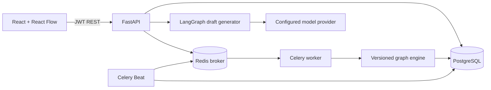

# Architecture

## Runtime

The web editor serializes graph nodes and edges as the workflow definition. Draft definitions may be edited; publishing validates the graph and stores an immutable `WorkflowVersion` snapshot. Each execution points to that version, records trigger input, and is queued only after its pending row commits. The worker reloads the execution and snapshot from PostgreSQL before dispatching node handlers.

## Tenancy and identity

Registration creates a user, organization, and owner membership in one transaction. JWTs include the user and active organization identifiers. Protected endpoints resolve membership and scope workflow, execution, schedule, webhook configuration, and credentials by organization on the backend. A webhook token is an unguessable per-workflow bearer secret and is accepted only for an enabled published workflow.

## Persistence

SQLAlchemy models cover users, organizations, memberships, workflows, immutable versions, workflow executions, node executions, credentials, and audit-log records. UUID-formatted identifiers and organization foreign keys are used. Alembic contains the initial schema revision. API startup also creates missing tables to keep local startup simple; production deployments should use a migration job and remove startup DDL.

## Async execution

The API writes an execution before sending its Celery task and returns HTTP 202. The worker commits running status and node records while executing. The browser polls the execution endpoint for persisted status; it does not simulate progress. Celery Beat scans enabled cron workflows once per minute and dispatches against the published version.

## Trust boundaries

LLM output is validated against a Pydantic structure, limited to registered node types, and never executed as code. Expressions perform dictionary lookup only. Credential values are encrypted at rest with Fernet and masked in responses. Provider errors are surfaced rather than replaced by success-shaped placeholders.
